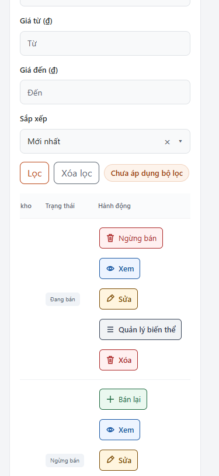
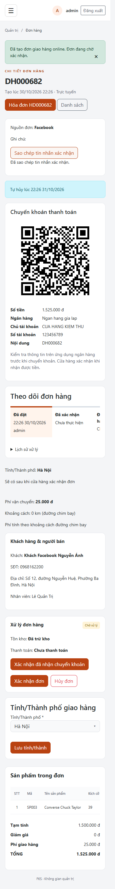
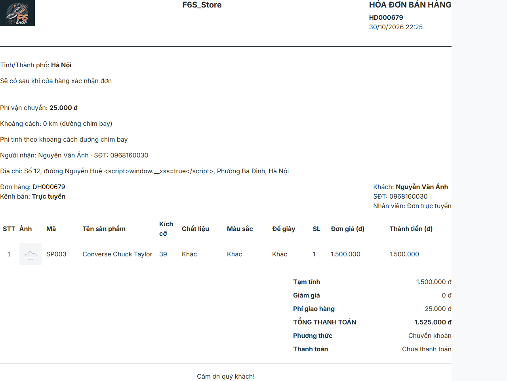

# Bổ sung địa chỉ, phí vận chuyển, đơn online POS, nút và logo

Nhánh `gop-y-giang-vien`, ngày 30/10/2026. Hoàn thành phần A–D trong một đợt thay đổi; không merge/push. Test dùng **shopbangiay_kt_20261030_gd16**, RESTORE mới không ghi đè từ full backup đọc được gần nhất `shopbangiay_kt_20261030_gd8_schema.bak` (17:02:44 ngày 30/10/2026). Không kết nối `shopbangiay` hoặc `shopbangiay_thu`. Logical file name trong backup không phải kết nối database nguồn. Sau các nhóm phá dữ liệu, dừng app và RESTORE checkpoint riêng của bản sao. App cổng **18210**, chờ log Started, `ddl-auto=validate`.

## Bảng nghiệm thu

| Hạng mục | Cách kiểm tra | Kết quả thực tế | PASS/FAIL/NOT TESTED |
|---|---|---|---|
| Schema/seed | 016 chạy hai lần; aggregate chạy hai lần; so metadata/COUNT/giá/tồn/đơn cũ | Không lỗi, lần hai giống lần một; 34 tỉnh, 3.321 phường; giá/tồn/trạng thái/tổng đơn cũ giữ nguyên | PASS |
| Hibernate | Khởi động bản build cuối validate | Started ở 18210, không báo thiếu schema | PASS |
| Địa chỉ phụ thuộc | Playwright chọn tỉnh/phường ở profile, checkout, POS; service từ chối khác tỉnh | Combo tìm nhanh chung; lưu tiếng Việt và snapshot; HTML trong số nhà được escape | PASS |
| Tâm phường/cache | HTTP stub + SELECT + test đơn vị | Tâm lưu DB, chọn lại không gọi provider; reverse có cache/rate/User-Agent; không HTTP trong transaction | PASS |
| GPS/bản đồ | Mock geolocation, cấp quyền, từ chối, không hỗ trợ, kéo ghim, provider lỗi | Hai viewport PASS; điểm ghim ưu tiên; kéo ghim đổi nấc phí; lỗi vẫn chọn tay/đặt đơn | PASS |
| Nấc phí | Unit các mốc 0/14,9/15/30/30,01/50/50,01/500 và thiếu điểm | 25.000/35.000/55.000 đúng ranh giới; Haversine điểm trùng=0, 1 độ xích đạo=111,20km | PASS |
| Miễn phí theo số lượng | 1 dòng SL2, hai dòng SL1; form thật + SELECT | SL≥2 phí=0, is_free_ship=true; SL1 có gợi ý mua thêm một | PASS |
| Chống giả phí | Form thật gửi shipping_fee=0, distance_km=99999 | SQL đơn vẫn shipping_fee=25.000, distance_km=0 theo điểm thật | PASS |
| Provider lỗi | Stub 503/timeout, tạo đơn COD bằng form | Đơn SL1 lưu 55.000 và ghi chú phí tạm tính; SL2 lưu 0; không 500 | PASS |
| QR/tổng/voucher | Giải mã canvas bằng jsQR; test tính voucher chung | QR=final_amount gồm ship; voucher giảm subtotal, không giảm ship | PASS |
| Doanh thu | SQL độc lập cạnh Dashboard; test version NULL/1 | Hôm nay SQL=trang=1.500.000đ. Chỉ đơn mới trừ ship; lịch sử giữ cách tính cũ | PASS |
| POS online/khách | Form COD/CK, cùng SĐT hai lần; SELECT customers/users/orders | ONLINE·FACEBOOK; đúng một khách, user_id=NULL, không tạo tài khoản | PASS |
| Luồng/kho | SQL trước/sau và UI CONFIRMED→PREPARING→SHIPPING→DELIVERED; nhánh hủy CK; gửi lặp | COD xác nhận mới trừ; CK đặt trừ ngay; hủy hoàn; gửi lặp không lặp log/kho | PASS |
| Hóa đơn/kênh/print | Danh sách lọc ONLINE/POS, chi tiết User/Admin, print | Có nguồn Facebook, phí/khoảng cách, snapshot và logo; đơn cũ vẫn 200 | PASS |
| Sao chép | Clipboard thật của browser, so từng ký tự sau chuẩn hóa CRLF Windows | Đủ tên/hàng/tiền/ship/tổng/địa chỉ/dự kiến; không tự gửi tin nhắn | PASS |
| Nút bảng | Grep + crawl từng bảng + các bảng AJAX/chờ/sắp hết | Có icon/chữ/màu, cao≥36px; đổi nhãn cập nhật màu/icon; confirm và POST/CSRF giữ nguyên | PASS |
| Logo | So SHA-256, HTTP ảnh/favicon/Leaflet, ảnh header/sidebar/auth/POS/in/GreenMail | Đúng ảnh người dùng, đúng tỷ lệ, favicon 32/180; email có CID logo; grep runtime logo SVG cũ=0 | PASS |
| Quyền/CSRF/IDOR | 8 nhóm bảo mật; ma trận khách/user/admin, thiếu/sai CSRF, hóa đơn người khác | 302/403/400 theo ngữ cảnh; chủ đơn 200, người khác 404; chi tiết ở JSON | PASS |
| Chất lượng browser | 88 lượt URL và các flow ở 1280/375 | Không JS runtime/console error, không tài nguyên 404, không trắng/tràn ngang trong ca PASS cuối | PASS |
| Maven | `.\mvnw.cmd -B -o clean test`, không skip | 208 test; failures=0, errors=0, skipped=0; BUILD SUCCESS | PASS |
| Audit UI tĩnh toàn repo | premium strict, so với HEAD 6109a2f | 143→150 findings. 7 mới: 1 ownership combo chưa được công cụ suy ra, 4 nút gắn handler JS đã test, 2 anchor nội bộ Leaflet. Không coi strict toàn repo là sạch | FAIL |
| Thiết bị/dịch vụ thật | GPS điện thoại, Nominatim/tile thật, app ngân hàng, client email thật | Chưa nghiệm thu bằng thiết bị/dịch vụ thật; test tự động dùng mock/GreenMail | NOT TESTED |

Browser: **42 ca/viewport cuối: PASS=42, FAIL=0**. Bảng này tách kết quả chức năng khỏi audit tĩnh bổ trợ. Lượt thử lỗi ban đầu do fixture/chờ animation/clipboard CRLF/mock tile được giữ ở `browser-attempt-summary.json`; mỗi mã đã có lượt chạy lại PASS. Lỗi CSS 32px là lỗi thật, đã sửa và chạy lại. Lượt đầu cấu hình mock tile chưa khớp host không có subdomain, dẫn tới yêu cầu tải tile bị lỗi DNS; đã sửa matcher và chạy lại toàn bộ luồng bản đồ bằng mock. Không coi lượt đó là kiểm thử OSM thật.

## SQL và output thô

Bằng chứng: [migration-comparison.json](evidence/gd16/migration-comparison.json), [016 lần 1](evidence/gd16/016-first.txt), [016 lần 2](evidence/gd16/016-second.txt), [aggregate lần 1](evidence/gd16/aggregate-first.txt), [aggregate lần 2](evidence/gd16/aggregate-second.txt), [Started/validate](evidence/gd16/startup-validate.txt), [output Maven](evidence/gd16/mvnw-clean-test.txt), [test summary](evidence/gd16/test-summary.json).

| Bảng | Trước 016 | Sau lần 1 | Sau lần 2 |
|---|---:|---:|---:|
| categories | 6 | 6 | 6 |
| cau_hinh_phi_ship | 0 | 1 | 1 |
| chat_lieu | 8 | 8 | 8 |
| customers | 14 | 14 | 14 |
| de_giay | 8 | 8 | 8 |
| dia_chi_nhan_hang | 7 | 7 | 7 |
| employees | 5 | 5 | 5 |
| inventory_logs | 63 | 63 | 63 |
| invoices | 28 | 28 | 28 |
| mau_sac | 11 | 11 | 11 |
| order_details | 35 | 35 | 35 |
| order_status_history | 28 | 28 | 28 |
| orders | 28 | 28 | 28 |
| phuong_xa | 0 | 3321 | 3321 |
| pos_held_items | 0 | 0 | 0 |
| pos_held_orders | 0 | 0 | 0 |
| product_images | 6 | 6 | 6 |
| product_variants | 20 | 20 | 20 |
| products | 10 | 10 | 10 |
| promotion_details | 7 | 7 | 7 |
| promotions | 5 | 5 | 5 |
| roles | 2 | 2 | 2 |
| sizes | 8 | 8 | 8 |
| ten_tinh_thanh_cu | 68 | 68 | 68 |
| tinh_thanh | 34 | 34 | 34 |
| users | 12 | 12 | 12 |
| vouchers | 15 | 15 | 15 |
| vung_giao_hang | 3 | 3 | 3 |

Bản TXT chuẩn hóa xuống dòng và bỏ padding cuối dòng để Git kiểm tra được; chuỗi console gốc giữ nguyên trong [raw-console-output.json](evidence/gd16/raw-console-output.json).

Các SELECT đã dùng (kết quả chụp trước RESTORE xóa dữ liệu thử):

```sql
SELECT id,order_type,order_source,status,payment_status,shipping_fee,distance_km,
 latitude,longitude,nguon_toa_do,is_free_ship,shipping_policy_version,
 total_amount,discount_amount,final_amount,dia_chi_giao_snapshot,ma_tinh_giao,ma_phuong_giao
FROM orders WHERE id IN (679,680,681,682,683,684);
SELECT id,quantity,status FROM product_variants WHERE id=5;
SELECT status,note,carrier,tracking_code FROM order_status_history WHERE order_id IN (680,682) ORDER BY id;
SELECT id,phone,user_id FROM customers WHERE phone IN ('0968162200','+84968162200');
SELECT id,ten,latitude,longitude,geocoded_at FROM phuong_xa WHERE id IN (1,2,3,4);
```

[Đơn và QR](evidence/gd16/commerce-proof.json), [SQL từng bước kho/lịch sử](evidence/gd16/transition-proof.json), [khách không tài khoản](evidence/gd16/pos-customer-dedupe.json), [đơn fallback/miễn phí](evidence/gd16/fallback-orders.json), [SQL doanh thu cạnh trang](evidence/gd16/independent-revenue.json), [HTTP và ca browser](evidence/gd16/browser-results.json).

Doanh thu dùng một biểu thức chung: `CASE WHEN COALESCE(shipping_policy_version,0)>=1 THEN final_amount-COALESCE(shipping_fee,0) ELSE final_amount END`; chỉ đổi số tiền của đơn theo cơ chế mới theo quyết định chủ dự án. Điều kiện PAID, loại CANCELLED/DELIVERY_FAILED giữ nguyên. Bán chạy vẫn dựa giá bản chụp ở chi tiết đơn. Không cập nhật cờ cho đơn lịch sử. QR và hóa đơn vẫn lấy final_amount gồm phí ship.

## Bảng có cột hành động

[Grep trước](evidence/gd16/action-grep-before.txt), [grep sau](evidence/gd16/action-grep-after.txt): tiêu đề cột giữ nguyên; chuyển trình bày bằng `nut-hanh-dong.js` và class CSS chung. [Kiểm kê DOM từng cột/nút/chiều cao](evidence/gd16/action-table-inventory.json). Các mã hóa đơn/mã đơn là liên kết định danh, không bị biến thành thao tác thay đổi dữ liệu. Sổ địa chỉ dùng combo/form và các nút có sẵn, không tạo thêm bảng giả.

| URL | Bảng | Số nút đo được tối đa | Kết quả |
|---|---|---:|---|
| /admin/dashboard | admin-bang-dieu-khien-5 | 2 | PASS |
| /admin/products-crud | admin-san-pham-danh-sach-1 | 50 | PASS |
| /admin/products-crud?page=1 | admin-san-pham-danh-sach-1 | 50 | PASS |
| /admin/products-crud/view/3 | product-editable-variants | 8 | PASS |
| /admin/variants | admin-bien-the-danh-sach-1 | 36 | PASS |
| /admin/categories | admin-danh-muc-kich-co-danh-sach-1 | 12 | PASS |
| /admin/sizes | admin-danh-muc-kich-co-danh-sach-1 | 16 | PASS |
| /admin/materials | admin-danh-muc-kich-co-danh-sach-1 | 23 | PASS |
| /admin/soles | admin-danh-muc-kich-co-danh-sach-1 | 23 | PASS |
| /admin/colors | admin-mau-sac-danh-sach-1 | 32 | PASS |
| /admin/inventory | admin-ton-kho-danh-sach-1 | 24 | PASS |
| /admin/inventory?stock=low | admin-ton-kho-danh-sach-1 | 6 | PASS |
| /admin/customers | admin-khach-hang-danh-sach-1 | 24 | PASS |
| /admin/employees | admin-nhan-vien-danh-sach-1 | 10 | PASS |
| /admin/vouchers | admin-voucher-danh-sach-1 | 24 | PASS |
| /admin/promotions | admin-khuyen-mai-danh-sach-1 | 15 | PASS |
| /admin/pos | admin-ban-tai-quay-ban-tai-quay-1 | 0 | PASS |
| /admin/pos | admin-ban-tai-quay-ban-tai-quay-2 | 0 | PASS |
| /admin/shipping-times | table | 3 | PASS |
| /orders | user-don-hang-1 | 5 | PASS |
| /cart | user-gio-hang-1 | 1 | PASS |

Các bảng rỗng trong lượt crawl chính được bổ sung fixture riêng: Dashboard sắp hết, hóa đơn chờ và kết quả tìm khách AJAX đều có ca PASS hai viewport trong browser-results. Ảnh đầy đủ từng URL ở `output/playwright/gd16-crawl-*.png` trên workspace; [manifest ảnh/kích thước/hash](evidence/gd16/screenshot-manifest.json). Ảnh tiêu biểu đã đưa vào `docs/evidence/gd16/images/`.

## URL thực tế

| URL | Vai trò | Status 1280 | Status 375 |
|---|---|---:|---:|
| /admin/dashboard | admin | 200 | 200 |
| /admin/products-crud | admin | 200 | 200 |
| /admin/products-crud?page=1 | admin | 200 | 200 |
| /admin/products-crud/view/3 | admin | 200 | 200 |
| /admin/variants | admin | 200 | 200 |
| /admin/categories | admin | 200 | 200 |
| /admin/sizes | admin | 200 | 200 |
| /admin/materials | admin | 200 | 200 |
| /admin/soles | admin | 200 | 200 |
| /admin/colors | admin | 200 | 200 |
| /admin/inventory | admin | 200 | 200 |
| /admin/inventory?stock=low | admin | 200 | 200 |
| /admin/customers | admin | 200 | 200 |
| /admin/customers/detail/100 | admin | 200 | 200 |
| /admin/customers/create | admin | 200 | 200 |
| /admin/employees | admin | 200 | 200 |
| /admin/employees/detail/1 | admin | 200 | 200 |
| /admin/vouchers | admin | 200 | 200 |
| /admin/promotions | admin | 200 | 200 |
| /admin/promotions/1/products | admin | 200 | 200 |
| /admin/orders | admin | 200 | 200 |
| /admin/orders/680 | admin | 200 | 200 |
| /admin/orders/1 | admin | 200 | 200 |
| /admin/invoices | admin | 200 | 200 |
| /admin/invoices/292 | admin | 200 | 200 |
| /admin/pos | admin | 200 | 200 |
| /admin/shipping-times | admin | 200 | 200 |
| /admin/statistics/revenue | admin | 200 | 200 |
| /admin/statistics/best-sellers | admin | 200 | 200 |
| /admin/account | admin | 200 | 200 |
| /profile | user | 200 | 200 |
| /orders | user | 200 | 200 |
| /orders/679 | user | 200 | 200 |
| /orders/679/hoa-don | user | 200 | 200 |
| /cart | user | 200 | 200 |
| /checkout | user | 200 | 200 |
| / | guest | 200 | 200 |
| /products | guest | 200 | 200 |
| /products/3 | guest | 200 | 200 |
| /category/1 | guest | 200 | 200 |
| /promotions | guest | 200 | 200 |
| /cart | guest | 200 | 200 |
| /login | guest | 200 | 200 |
| /register | guest | 200 | 200 |

Bản build cuối đã crawl thêm các URL chính sau clean test; xem nhóm `final-build-crawl-*`. Ma trận quyền bao gồm GET /shipping/config, /shipping/wards, /admin/pos, /admin/shipping-times; POST /shipping/reverse, /shipping/quote, /admin/pos/online-orders, /admin/shipping-times/settings với CSRF thiếu/sai/đúng, và hóa đơn khác chủ. Các mã lỗi chủ động trong bài bảo mật không phải lỗi tài nguyên của trang.

## Lỗi và giới hạn

| Mã | File:dòng | Nguyên nhân/cách sửa | Bằng chứng chạy lại |
|---|---|---|---|
| BS-01 | src/main/resources/static/css/he-thong-thiet-ke.css:231 | CSS catalog cũ đè min-height còn32px; class dùng chung ưu tiên36px | all-tables-crawl-admin và final-action-buttons-visible PASS; minHeight≥36 |
| BS-02 | src/main/java/com/example/demodatn/config/StaticResourceConfig.java:31 | /images trước đây chỉ tìm thư mục anh; thêm thư mục images và giữ fallback ảnh cũ, thay alias logo | logo/favicon/placeholder không 404 trong crawl; assets=200 |
| BS-03 | src/main/java/com/example/demodatn/service/donhang/ShippingFeeService.java:63 | Chặn mốc phí không biểu diễn được ở DECIMAL(10,2), tránh lỗi constraint khi nhập quá hai số lẻ | unit config + final-settings-malformed-number-and-precision=200, lỗi tiếng Việt |
| BS-04 | src/main/resources/static/js/nut-hanh-dong.js:20 | Trang trí lại theo nhãn hiện tại, tránh màu cũ/icon mất khi dòng AJAX đổi nhãn | dynamic-action-color-and-icon hai viewport PASS |

Audit strict có các giới hạn nêu trên và output [premium-audit-diff.json](evidence/gd16/premium-audit-diff.json). Các nút GPS/tâm phường/áp voucher/copy được gắn handler ở file JS riêng, các anchor `#` của Leaflet có handler thư viện; không sửa thư viện vendor chỉ để qua grep. Native select được nâng cấp bởi combo-box.js theo DESIGN.md/UX-CONTRACT.md; audit chưa có manifest ownership toàn repo. Không mở rộng đợt này để xử lý 143 findings có từ trước.

## Ảnh tiêu biểu







## Giả định và cách thử thật

- Danh mục hành chính hiện hành hai cấp; tâm phường NULL đến khi tra được, không ép sửa chuỗi địa chỉ của đơn cũ. Kho là điểm xấp xỉ đã đối chiếu bản đồ, Admin cần chỉnh nếu vị trí nhận hàng thực tế khác.
- Điểm ghim/GPS ưu tiên khi sửa tên địa chỉ; muốn tính theo tâm phường bấm Dùng tâm phường/xã. Phí là đường chim bay; không phải quãng đường vận tải.
- Đơn chuyển khoản tạo ở POS được tạo trước để có mã đơn thật, rồi QR xuất hiện ở chi tiết đơn; không xác nhận tiền tự động.
- GPS thật: chạy HTTPS hoặc localhost, cấp/từ chối quyền trên điện thoại, kéo/bấm ghim, đối chiếu địa chỉ và phí. Geocoder/tile thật: cấu hình URL/User-Agent liên hệ, thử ở tốc độ đúng chính sách, kiểm tra attribution và fallback khi mất mạng. Không suy kết quả thật từ mock.
- Ngân hàng thật: cấu hình tài khoản đúng của shop, tạo đơn giá trị nhỏ, quét và so người nhận/số tiền/nội dung, chỉ xác nhận tiền sau khi kiểm tra giao dịch. Email thật: cấu hình SMTP môi trường, gửi tới hộp thử, kiểm tra ảnh CID và bản text. Các mục này NOT TESTED.

Nguồn/phiên bản/giấy phép và cache/rate: [NGUON_DIA_CHI_BAN_DO.md](NGUON_DIA_CHI_BAN_DO.md). Logo nguồn [hash/kích thước](evidence/gd16/logo-source.json), [grep logo cũ](evidence/gd16/old-logo-grep.txt); chứng cứ HTML cũ trong docs không bị sửa lịch sử.

## Lệnh nâng schema trên DB thật — chỉ hướng dẫn, chưa thực thi

Sao lưu DB thật và xác nhận 004→015 đã áp dụng trước. Tại thư mục project, dùng Windows authentication hoặc cơ chế xác thực triển khai sẵn, không đưa mật khẩu vào repo. Migration có guard và context cho thao tác nâng cấp được chủ động cho phép:

```powershell
# CHỈ CHẠY SAU KHI SAO LƯU VÀ KIỂM TRA ĐÚNG SERVER/DATABASE.
$migration = "EXEC sys.sp_set_session_context @key=N'shop.allow-production-migration', @value=1;`nGO`n" +
    (Get-Content -LiteralPath database/migrations/016_dia_chi_phi_ship_don_online.sql -Raw -Encoding UTF8)
$migration | sqlcmd -S '<SQL_SERVER>' -d shopbangiay -E -C -b -f 65001
```

Nếu chưa đủ schema trước đó, áp dụng theo thứ tự 004→005→006→007→008→009→010→011→012→013→014→015→016 hoặc aggregate đã kiểm thử trên bản sao. Khởi động với `spring.jpa.hibernate.ddl-auto=validate`. Các lệnh trên không được chạy trong đợt này lên shopbangiay/shopbangiay_thu.

Sau kiểm thử, bản sao được RESTORE về checkpoint sạch; tài khoản/đơn/khách/địa chỉ/điểm cache/fixture kho phát sinh thử không còn. Xem `evidence/gd16/final-restore.json` và output RESTORE. Một commit cho đợt bổ sung; dừng, không merge.
