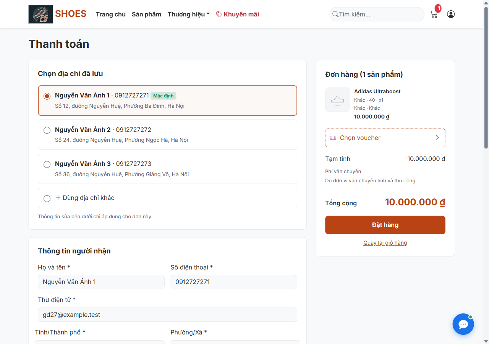
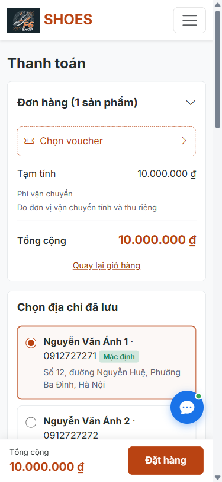
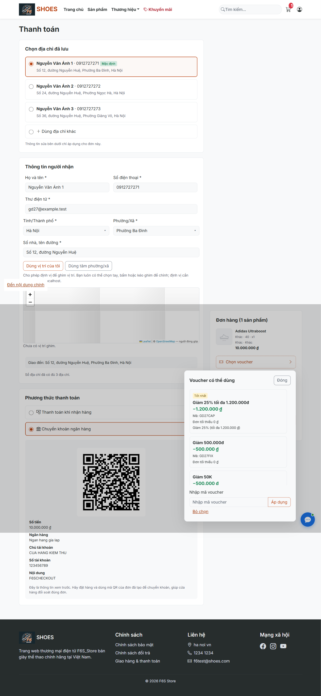
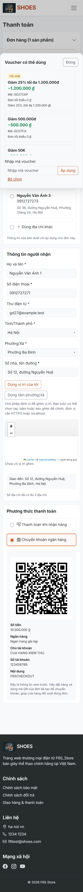

# Giai đoạn 27 — Giao diện thanh toán của khách

Ngày kiểm tra: 04/11/2026. Nhánh `hoan-thien-chat-thanh-toan`, tạo từ `606ead2` (đã có Giai đoạn 26). Chỉ triển khai Giai đoạn 27; không push/merge.

Giao diện và các luồng checkout dưới đây đã chạy được. **Chưa đạt nghiệm thu toàn dự án:** full-suite còn lỗi đã có trước thay đổi, một unit geocoding không ổn định và crawl Admin phát hiện lỗi ngoài checkout. Không báo các mục này PASS.

## Bảng nghiệm thu

| Hạng mục | Cách kiểm tra | Kết quả thực tế | PASS/FAIL/NOT TESTED |
|---|---|---|---|
| Bản sao mới, cổng riêng | RESTORE từ backup đọc được gần nhất; guard DB chưa tồn tại; log app | `shopbangiay_kt_20261104_gd27`, backup kết thúc `2026-11-03 22:08:27`; cổng `18427`; [output](evidence/gd27/restore-new.txt) | PASS |
| Schema validate | Khởi động `ddl-auto=validate` sau áp dụng migration 023–026 còn thiếu trên bản sao | Log `Started DemoDatnApplication` lúc `21:37:10.481`; [log](evidence/gd27/startup.txt) | PASS |
| Hai cột, sticky, mobile thu gọn/thanh đáy | Playwright 1280×900 và 375×812, đo tọa độ, scrollWidth | Desktop hai thẻ đầu cùng y; mobile đơn hàng đứng trước; thanh đáy fixed; không tràn ngang | PASS |
| Ba địa chỉ, mặc định và Giao đến | Chọn lần lượt 3 radio; so từng trường với SQL; kiểm tra test mặc định thứ hai | Tên/SĐT/tỉnh/phường/địa chỉ đổi đúng; `ShippingAddressIntegrationTest.checkoutSnapshotsAllThreeAddressesAndTemporaryEdit` vẫn chạy đạt | PASS |
| Dùng địa chỉ khác; chưa có sổ; lưu tùy chọn; lỗi ô | Playwright xóa trắng bằng radio, nhập tay bằng combo chung, lưu và SELECT | Đơn tạo được; địa chỉ `Số 12, đường Nguyễn Huệ` đọc lại đúng; lỗi tên hiện cạnh ô; [SQL](evidence/gd27/manual-address-sql.json) | PASS |
| Danh sách voucher và Tốt nhất | SELECT độc lập so toàn bộ API; thử điều kiện tối thiểu, trần, tương lai/hết hạn | GD27CAP giảm 1.200.000; GD27FIX 500.000; GD27MIN khóa, thiếu 10.000.000; FUTURE/EXPIRED không hiện; [SQL](evidence/gd27/independent-vouchers.json) | PASS |
| Chọn/đổi/bỏ và nhập mã voucher; QR | Thao tác thật ở 2 viewport; giải mã canvas bằng jsQR; nhập mã trong panel | Tổng/QR đổi theo phản hồi server; payload giải mã trùng dữ liệu; Escape trả focus; drawer/dropdown nằm trong viewport | PASS |
| Giá khuyến mãi và giảm voucher sau khuyến mãi | Tạo đợt giả 25% trên bản sao; nhìn giá gạch; SELECT đơn | 10.000.000 gạch ngang → 7.500.000; voucher 1.200.000 → tổng 6.300.000; [SQL](evidence/gd27/promotion-double-submit-sql.json) | PASS |
| COD/chuyển khoản thật, chi tiết và kho | Đặt bằng form desktop/mobile; SELECT orders/order_details/product_variants | COD 8.800.000, kho 100→100; chuyển khoản 8.800.000, kho 100→99; QR đơn chứa 8.800.000 | PASS |
| Giả discount/total và voucher sai | Chèn hidden total=1, discount=999999999; POST voucher không tồn tại | Hai đơn hợp lệ vẫn tổng 8.800.000 theo server; voucher sai trả 302 về checkout, COUNT đơn không đổi | PASS |
| Ngừng bán/hết hàng | Giỏ có hàng trước khi đổi trạng thái/tồn trên bản sao; GET và POST trực tiếp | Cảnh báo trong đơn hàng, hai nút khóa; POST ngừng bán bị chuyển về giỏ; COUNT không đổi | PASS |
| Chống bấm đúp, đang xử lý | Quan sát ngay sau submit; gọi requestSubmit lần hai khi request đầu chờ | Nút disabled, chữ Đang xử lý…; chỉ một POST và đúng một đơn COD mới; [SQL trước/sau](evidence/gd27/promotion-double-submit-sql.json) | PASS |
| 8 kịch bản bảo mật | 6 POST thiếu/sai CSRF; địa chỉ người khác; User ghi Admin | `403,403,403,403,403,403,404,403`; không đổi dữ liệu | PASS |
| JS/404/tràn ngang ở checkout | Console, pageerror, request và geometry trong các case đạt | Không pageerror/console error ứng dụng trong các lượt đạt; không tài nguyên nội bộ 404; 375px không tràn | PASS |
| Crawl toàn link Khách/User | BFS đến hết queue, giữ vai trò; [bảng URL](evidence/gd27/URL_STATUS.md) | Khách 20, User 29 URL; không status ≥400, không thiếu CSRF ở form POST | PASS |
| Crawl toàn link Admin | BFS đến hết queue | 518 URL; `/admin/chatbot-faq/new` 500; `/admin/pos` rộng 1415px ở viewport1280; ngoài phạm vi sửa | FAIL |
| 5 test mới | 4 CheckoutPresentationIntegrationTest + 1 CheckoutVoucherOptionsTest | 5/5 đạt, 0 skip; xem summary Maven | PASS |
| `mvnw clean test` toàn bộ | Restore trước chạy; không skip; đối chứng HEAD trước GD27 | 287 test: 23 failure, 2 error, 0 skip. Baseline282:23 failure,1 error. Geocoding chạy riêng lại4/4 đạt; [đối chứng](evidence/gd27/test-comparison.json) | FAIL |
| Audit UI tĩnh | Chạy audit_project.py --mode strict | Công cụ báo218 mục; có lỗi cũ và false positive không nhận ra addEventListener của5 nút checkout. Hành động thật đã chạy bằng browser; không tuyên bố audit toàn repo đạt | FAIL |
| Dọn dữ liệu sau thử | Dừng đúng app riêng, RESTORE checkpoint; so COUNT tất cả bảng gốc và giá/tồn | COUNT bảng gốc trùng, giá/tồn biến thể khôi phục, user/voucher/promotion GD27 còn0; [output](evidence/gd27/final-restore.json) | PASS |
| So ảnh với ảnh mẫu | Kiểm tra đầu vào của yêu cầu này | Không có ảnh mẫu đính kèm ở Giai đoạn27; chỉ đối chiếu bố cục mô tả và ảnh chụp thực tế | NOT TESTED |
| Bản đồ/GPS và chuyển tiền ngân hàng thật | Không thực hiện dịch vụ/thiết bị thật | Tile OSM giả lập do DNS ngoài lỗi; QR được giải mã cục bộ, không thực chuyển tiền | NOT TESTED |

Bằng chứng đầy đủ: [browser-results.json](evidence/gd27/browser-results.json). Giữ cả các lượt thử chưa đạt; lỗi harness (selector có thêm form chatbot, Location tuyệt đối, đọc trạng thái sau khi trang đã chuyển, script giữ request gây timeout) đã sửa và chạy lại. Kết quả crawl Admin phải đọc `proof.failures`/`proof.overflows`: cờ PASS của harness chỉ cho biết crawl chạy hết, không đồng nghĩa mọi URL đạt.

## Ảnh chụp

| Desktop 1280 | Mobile 375 |
|---|---|
|  |  |
|  |  |

## Bằng chứng SQL và status thô

Các file SQL/JSON liên kết ở đây chỉ chứa dữ liệu thử và kết quả cần đối chiếu; không chứa cookie, token phiên, mật khẩu hoặc cấu hình datasource.

```sql
SELECT id,order_code,status,payment_method,payment_status,total_amount,
       discount_amount,shipping_fee,final_amount,receiver_name,phone_number,
       dia_chi_giao_snapshot,da_tru_kho
FROM orders WHERE customer_id=<ID_KHACH_GD27> ORDER BY id;
SELECT d.order_id,d.product_variant_id,d.quantity,d.price,d.total_price,
       d.ten_mau_sac,d.ten_de_giay
FROM order_details d JOIN orders o ON o.id=d.order_id
WHERE o.customer_id=<ID_KHACH_GD27> ORDER BY d.id;
SELECT id,quantity,status FROM product_variants WHERE id=3;
```

| Lượt đặt | order_id | Tạm tính | Giảm | Phí ship tính vào tổng | Tổng | Tồn trước → sau | da_tru_kho |
|---|---|---|---|---|---|---|---|
| COD | 675 | 10.000.000 | 1.200.000 | 0 | 8.800.000 | 100 → 100 | false |
| BANK_TRANSFER | 676 | 10.000.000 | 1.200.000 | 0 | 8.800.000 | 100 → 99 | true |

[Trước đơn](evidence/gd27/before-orders.json), [sau COD](evidence/gd27/after-cod.json), [sau chuyển khoản và chi tiết](evidence/gd27/after-bank_transfer.json). Hai hidden giả `total=1` và `discount=999999999` không quyết định số tiền lưu.

[SELECT voucher độc lập](evidence/gd27/independent_vouchers.sql) dùng CASE/ROUND/MIN trực tiếp trên dữ liệu, không gọi Java service; toàn bộ mã/eligible/missing/discount được so với API. Case khuyến mãi sau cùng so `7.500.000 - 1.200.000 = 6.300.000`, không thay các đơn thử 675/676 trong bằng chứng đã lưu trước RESTORE.

```
GET /checkout                         200
GET /checkout/vouchers                200
POST /checkout/preview                200 (CSRF đúng)
POST /checkout/place                  302 → /orders/success/{id}
POST /checkout/place (voucher sai)    302 → /checkout; COUNT trước=sau
POST /checkout/place (ngừng bán)      302 → /cart; COUNT trước=sau
POST /checkout/place (địa chỉ khác)   404
POST thiếu/sai CSRF                  403
POST /admin/products-crud/save User   403
```

## Chỗ đã thay đổi so với giai đoạn cũ

- Checkout chuyển bảng nhiều cột sang danh sách thẻ hàng, khung desktop2:1; mobile đơn hàng thu gọn ở đầu và thanh đặt ở đáy. Không bỏ dữ liệu địa chỉ/email/phương thức mà luồng cũ cần.
- Combo sổ địa chỉ thay bằng radio, thêm lựa chọn xóa trắng và lưu tùy chọn. `CheckoutService` chỉ phối hợp `ShippingAddressService.save` với `OrderService.placeOrder` trong một transaction; sửa tạm không cập nhật sổ.
- Voucher nhập mã đơn thuần được bổ sung danh sách, nhãn Tốt nhất, điều kiện tối thiểu và AJAX. `VoucherService.checkoutOptions` gọi đúng công thức `calculate` và `DiscountEffectivity` hiện có. Phí ship vẫn thu riêng theo Giai đoạn19.
- Hiện QR xem trước trước khi đặt. QR này dùng nội dung `F6SCHECKOUT`, không phải mã đơn; UI nhắc đặt hàng rồi dùng QR của đơn thật để đối soát. Trang thành công vẫn dùng QR theo mã đơn do cơ chế cũ tạo, không lưu tham chiếu xem trước vào đơn, không xác nhận thanh toán tự động.
- Giỏ có hàng ngừng bán giữ cảnh báo trong thẻ checkout thay vì GET chuyển ngay về giỏ; POST vẫn kiểm tra qua dịch vụ và bị chặn.
- Hai assertion cũ được cập nhật vì UI mới được yêu cầu: `Giao tới` → `Chọn địa chỉ đã lưu`; checkout GET ngừng bán 302 →200 có cảnh báo. Không xóa test; toàn bộ kiểm tra snapshot/tồn còn giữ.

## Lỗi trong phạm vi đã sửa

| Mã | File:dòng | Nguyên nhân | Sửa và bằng chứng chạy lại |
|---|---|---|---|
| GD27-01 | OrderController.java:40 | Hidden coordinateSource không dùng được form gửi thành chuỗi rỗng; DB CK_orders_point_source không chấp nhận giá trị rỗng | Binder riêng checkout đổi trống thành NULL; thêm param trống trong test hồi quy; đặt COD/chuyển khoản thật không còn500 |
| GD27-02 | static/css/thanh-toan.css (media mobile) | Chatbot nổi che vị trí nút đặt khi có thanh đáy mới | Chỉ ở checkout, đẩy chatbot lên trên thanh; Playwright đo hai hình chữ nhật không giao nhau |
| GD27-03 | static/js/thanh-toan.js:71 | Chiều cao panel voucher thay đổi sau tải dữ liệu có thể vượt viewport | Tính lại vị trí sau khi danh sách tải xong/resize; hai viewport đo popup nằm trong cửa sổ |

## Lỗi ngoài phạm vi và test chưa sạch

Baseline riêng tại commit606ead2 được clean test trên cùng bản sao đã RESTORE. [Danh sách từng test lỗi](evidence/gd27/TEST_FAILURES.md), [summary baseline](evidence/gd27/baseline-test-summary.txt), [summary cuối](evidence/gd27/maven-test-summary.txt).

- 24 test lỗi ở baseline (23 failure+1 error) vẫn lỗi ở bản cuối: nhóm guest403 so với302 kỳ vọng, POS/hóa đơn, phân trang, doanh thu/tiền mặt/chuyển khoản. Không sửa business hoặc đổi các assertion đó để cho qua.
- Lần full cuối có thêm `GeocodingServiceTest.wardCenterIsValidatedAndPersistedOnce` lỗi `No value present` tại dòng44; file test/service này không đổi. Chạy riêng lại4 test:4 đạt,0skip, BUILD SUCCESS. Chưa đủ bằng chứng kết luận nguyên nhân lỗi không ổn định; không tính full-suite PASS. [Output riêng](evidence/gd27/geocoding-rerun-summary.txt).
- FAQ500: `ChatbotFaqRepository.java:35` CAST phần sau KB thành int, gặp dữ liệu seed `KB_ADMIN_01` của migration026. Không sửa ngoài checkout.
- `/admin/pos` có scrollWidth1415 tại1280; không đổi giao diện POS trong Giai đoạn27.
- Audit tĩnh toàn repo không nhận diện listener gắn bằng JS cho5 nút checkout; các nút này đã có case browser thực chạy. Các phát hiện ngoài checkout được giữ trong JSON, không âm thầm coi là đạt.

## Database, migration và triển khai

Giai đoạn27 không thay entity/schema, không cần migration027; không sửa chay_tat_ca.sql/shopgiay.sql cho một DDL không tồn tại. Bản backup thiếu023–026 nên đã áp dụng **script có sẵn** chỉ trên bản sao. Không DROP bảng/cột dữ liệu.

Database đã đủ Giai đoạn26: sao lưu trước triển khai, không cần chạy thêm SQL cho Giai đoạn27. Nếu database đích còn thiếu023–026, người vận hành sau khi sao lưu chạy lần lượt (thay tham số bằng cấu hình của mình):

```powershell
sqlcmd -S <SERVER> -E -d <DB_DICH> -b -f 65001 -i database/migrations/023_thanh_toan_ket_hop_pos.sql
sqlcmd -S <SERVER> -E -d <DB_DICH> -b -f 65001 -i database/migrations/024_pos_giao_hang_va_order_mail_log.sql
sqlcmd -S <SERVER> -E -d <DB_DICH> -b -f 65001 -i database/migrations/025_chatbot_va_phieu_ho_tro.sql
sqlcmd -S <SERVER> -E -d <DB_DICH> -b -f 65001 -i database/migrations/026_tro_ly_admin.sql
```

Các lệnh trên là hướng dẫn, chưa chạy trên database thật. Nên xử lý các lỗi nền được liệt kê trước khi tuyên bố toàn bộ dự án đạt.

COUNT dưới đây: trước khi bổ sung schema còn thiếu trên bản sao và sau RESTORE checkpoint cuối (checkpoint có023–026). Mọi bảng gốc giữ nguyên COUNT, bảng mới chỉ có dữ liệu seed của migration. Thử nghiệm GD27 đã được loại bằng RESTORE, không xóa tay dữ liệu gốc.

| Bảng | Trước bổ sung schema | Sau RESTORE cuối |
|---|---|---|
| `admin_chat_audit` | Chưa có bảng | 0 |
| `admin_chat_hoi_thoai` | Chưa có bảng | 0 |
| `admin_chat_tin_nhan` | Chưa có bảng | 0 |
| `categories` | 6 | 6 |
| `cau_hinh_phi_ship` | 1 | 1 |
| `chat_hoi_thoai` | Chưa có bảng | 0 |
| `chat_lieu` | 8 | 8 |
| `chat_tin_nhan` | Chưa có bảng | 0 |
| `chatbot_faq` | Chưa có bảng | 9 |
| `customers` | 14 | 14 |
| `danh_gia` | 0 | 0 |
| `de_giay` | 8 | 8 |
| `dia_chi_nhan_hang` | 7 | 7 |
| `employees` | 5 | 5 |
| `inventory_logs` | 63 | 63 |
| `invoices` | 28 | 28 |
| `mau_sac` | 11 | 11 |
| `order_details` | 35 | 35 |
| `order_mail_log` | Chưa có bảng | 0 |
| `order_status_history` | 28 | 28 |
| `orders` | 28 | 28 |
| `phieu_ho_tro` | Chưa có bảng | 0 |
| `phuong_xa` | 3321 | 3321 |
| `pos_held_items` | 0 | 0 |
| `pos_held_orders` | 0 | 0 |
| `product_images` | 6 | 6 |
| `product_variants` | 20 | 20 |
| `products` | 10 | 10 |
| `promotion_details` | 7 | 7 |
| `promotions` | 5 | 5 |
| `roles` | 3 | 3 |
| `sizes` | 8 | 8 |
| `ten_tinh_thanh_cu` | 68 | 68 |
| `tinh_thanh` | 34 | 34 |
| `users` | 12 | 12 |
| `vouchers` | 15 | 15 |
| `vung_giao_hang` | 3 | 3 |
| `yeu_thich` | 0 | 0 |

**Xác nhận:** không mở kết nối tới `shopbangiay` hoặc `shopbangiay_thu`. Kết nối SQL chỉ tới master để đọc metadata/RESTORE và bản sao mới; tên logic trong file backup không phải kết nối database nguồn. App kiểm thử đã dừng; bản sao đã khôi phục. Không đẩy Git/không merge. Dừng sau Giai đoạn27.
