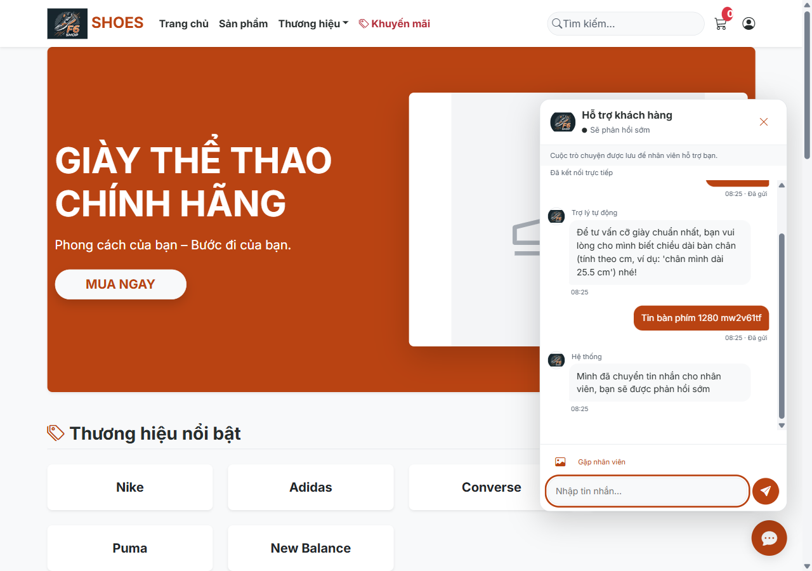
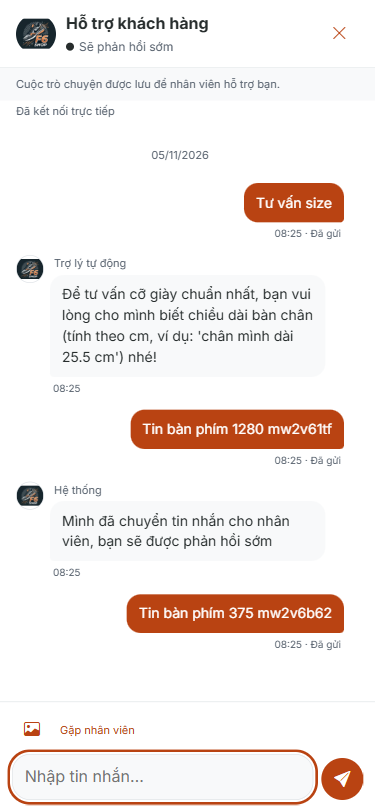

# Giai đoạn 28 — Chat hỗ trợ khách hàng

Nhánh `hoan-thien-chat-thanh-toan`. Phạm vi: lõi hội thoại, API nhân viên và khung chat khách; **không làm trang inbox nhân viên của giai đoạn 29**. Không sửa giá, kho, doanh thu, hủy đơn.

## Môi trường và bằng chứng

Chỉ kết nối bản sao mới **shopbangiay_kt_20261104_gd28** và `master` để đọc metadata/RESTORE. Tạo mới từ full backup đọc được gần nhất lúc bắt đầu (04/11/2026 21:11:31); guard từ chối nếu tên bản sao đã tồn tại. Không kết nối `shopbangiay` hoặc `shopbangiay_thu`. App cổng **18428**, `ddl-auto=validate`, RULES; không gọi AI thật. Sau nhóm test phá dữ liệu, dừng đúng PID/port và RESTORE checkpoint của chính bản sao này; không ghi đè DB có sẵn của người dùng.

Bằng chứng thô trong [evidence/gd28](evidence/gd28/URL_STATUS.md): JSON SQL, HTTP status, lỗi STOMP, mọi lượt browser (kể cả lượt FAIL), tóm tắt Maven, ảnh desktop/mobile. Cookies, CSRF token, mật khẩu fixture và cấu hình local không được đưa vào Git.

## Kết quả nghiệm thu

Tổng theo bảng: **26 PASS / 4 FAIL / 2 NOT TESTED**. Các FAIL toàn dự án/audit được giữ rõ, không suy thành PASS của cả website.

| Hạng mục | Cách kiểm tra | Kết quả thực tế | PASS/FAIL/NOT TESTED |
|---|---|---|---|
| Migration 027, không tạo bảng chat trùng | RESTORE mới, thêm dữ liệu chat cũ giả, chạy 027 hai lần | COUNT/schema/sequence lần 1 = lần 2; câu tiếng Việt giữ nguyên; sender USER → KHACH | PASS |
| Schema | Chạy app `ddl-auto=validate`, chờ Started | App Started trên 18428, không lỗi thiếu cột/bảng | PASS |
| Danh tính ẩn danh | Form thật Họ tên/liên hệ, kiểm tra cookie | Cookie HttpOnly + SameSite=Lax, token ngẫu nhiên; DB chỉ lưu hash cột riêng | PASS |
| Gộp khi đăng nhập | Guest đã có tin + một tin mất mạng, đăng nhập khách đã có hội thoại | Tin/lịch sử gộp, cookie xóa, outbox đổi scope, clientId chỉ có 1 dòng DB | PASS |
| Đóng/mở lại cùng hội thoại | Integration: staff đóng rồi khách gửi | Cùng ID, trạng thái mở lại; không tạo hội thoại mới | PASS |
| Trợ lý tự động | UI Tư vấn size; unit RULES và mock LLM | Có nhãn Trợ lý tự động, không gọi AI thật; không khớp vào hàng chờ | PASS |
| Nhân viên nhận thì trợ lý dừng | Hai context + unit race khi provider đang xử lý | Số tin TRO_LY trước/sau nhân viên trả lời không tăng | PASS |
| Realtime sau commit | Khách gửi, context ROLE_EMPLOYEE nhận event rồi GET API | 42 ms, bản ghi đọc được trước khi render bên nhận | PASS |
| Đã xem/đang nhập | Nhân viên API read/typing, khách quan sát | Đã xem và đang nhập hiện đúng; SQL counter = COUNT chưa đọc độc lập | PASS |
| Badge/tab | Đóng chat, nhân viên gửi, mở lại | Badge 1 và title (1); mở xong về 0 | PASS |
| Polling và nối lại | Context chặn toàn bộ /ws/support/** rồi bỏ chặn | Nhận sau 4357 ms qua fallback; nối lại sau 1973 ms | PASS |
| Tải lại/lịch sử 30 tin | Reload; seed riêng 70 tin giả, cuộn lên và tải tiếp | 30 → 60 → 70; 70 ID khác nhau, còn tin đầu | PASS |
| Outbox/idempotency | Chặn POST rồi đăng nhập/nối lại; gửi đôi đồng thời cùng clientId | Tin không mất; hai phản hồi cùng ID, SELECT chỉ 1 dòng | PASS |
| Ảnh thật | Upload PNG/JPG/WEBP qua UI | Cả ba lưu tên ngẫu nhiên, trả private controller, người khác 403 | PASS |
| Ảnh giả/lớn | Fake PNG và >3 MiB qua HTTP thật | 400, không lưu ảnh giả/lớn | PASS |
| Thẻ sản phẩm/đơn | Nút trên chi tiết sản phẩm; combo đơn của mình | Có ảnh/tên/giá/link; đơn người khác 403; metadata do server lấy | PASS |
| XSS/che dữ liệu | Gửi script, số thẻ và mật khẩu giả | Script thành văn bản; số thẻ/mật khẩu bị che trước DB; không chạy mã | PASS |
| Hạn mức phút/spam | 30 POST thành công rồi tin 31; lặp nội dung | 30 × 200; tin thứ 31 và spam 429 | PASS |
| Hạn mức IP ngày | SQL bù dữ liệu giả tới 500, gửi ở hội thoại khác | 429; COUNT trước/sau yêu cầu đều 500 | PASS |
| Quyền REST | Owner khác GET/POST, user gọi staff API, cookie giả | Tất cả 403 | PASS |
| Quyền WebSocket | Subscribe hội thoại khác, SEND trực tiếp topic | Nhận ERROR frame; không có nội dung hội thoại bị lộ | PASS |
| CSRF REST/CONNECT | Thiếu và sai token | REST 403; STOMP CONNECT bị ERROR, không subscribe được | PASS |
| API nhân viên | Đăng nhập ROLE_EMPLOYEE, GET /admin/support-chat | 200, widget khách không hiện trong admin | PASS |
| Viewport/bàn phím | Playwright 1280 và 375 | Không tràn chat, mobile toàn màn hình, Enter/Shift+Enter/Escape/focus hoạt động | PASS |
| Giữ dữ liệu/lọc log | Integration retention và kiểm tra log sau tin bí mật giả | Xem output kiểm tra cuối ở evidence; không ghi nội dung/tokens vào log dịch vụ chat | PASS |
| Route cũ | POST ba endpoint chatbot với CSRF | 302 → /api/support/session; frontend mới không tham chiếu endpoint cũ | PASS |
| Test toàn bộ | mvnw clean test, không skip | 305 test: 22 failure + 1 error, 0 skip; không có tên test lỗi mới so baseline | FAIL |
| Crawl toàn bộ link nội bộ | BFS từ menu/trang chính, đi tới khi hết link | Guest20, User24, Admin511; FAQ/new 500 và POS tràn ngang có từ GD27 | FAIL |
| Console toàn website | Thu console trong crawl | Có DNS lỗi ở tài nguyên CDN/font layout cũ; ca chat cuối không lỗi JS | FAIL |
| Kiểm tra UI tĩnh strict | audit_project.py --mode strict | 224 findings toàn repo; gồm nhận nhầm handler gắn qua JS, select do combo-box.js sở hữu; giữ raw output, chưa sạch toàn repo | FAIL |
| HTTPS/điện thoại thật, nhiều instance | Không có môi trường/thiết bị triển khai trong phiên này | Chỉ kiểm thử Chromium localhost; hướng dẫn trong README | NOT TESTED |
| LLM nhà cung cấp thật | Không gọi nhà cung cấp theo yêu cầu | RULES và mock LLM đã test; provider thật chưa test | NOT TESTED |

## SQL và status thô

Các file `legacy-before.json`, `schema-first.json`, `schema-second.json` chứa COUNT tất cả bảng và metadata hai bảng chat. Câu chữ trước/sau: `Xin chào kiểm thử dữ liệu cũ` giữ đúng; sau migration mã `CH0001`, loại KHACH, lịch sử cũ được xem là đã đọc. Không dùng session_id cũ do client chọn làm token quyền.

Các truy vấn kiểm tra chính (output đầy đủ ở file JSON tương ứng):

```sql
SELECT t.name,SUM(p.rows) n
FROM sys.tables t JOIN sys.partitions p ON p.object_id=t.object_id AND p.index_id IN(0,1)
GROUP BY t.name ORDER BY t.name;
SELECT id,ma,customer_id,trang_thai,chua_doc_khach,chua_doc_nhan_vien
FROM chat_hoi_thoai ORDER BY id;
SELECT id,hoi_thoai_id,nguoi_gui_loai,loai,noi_dung,tep_dinh_kem,payload_json,client_id
FROM chat_tin_nhan ORDER BY id;
SELECT COUNT(*) FROM chat_tin_nhan
WHERE hoi_thoai_id=@id AND client_id=@clientId; -- 1 sau hai lần gửi cùng mã
SELECT COUNT(*) FROM chat_tin_nhan
WHERE ip_address=@ip AND created_at>=CONVERT(DATE,GETDATE()); -- 500 trước và sau yêu cầu bị chặn
```

- [SQL counter độc lập](evidence/gd28/realtime-sql-after.json), [SQL thẻ/ảnh/tin đã che](evidence/gd28/cards-images-sql.json), [SQL gộp](evidence/gd28/merge-sql.json), [hạn mức ngày](evidence/gd28/rate-day-proof.json).
- [Tất cả URL | vai trò | status](evidence/gd28/URL_STATUS.md), [8 nhóm bảo mật](evidence/gd28/security-proof.json), [realtime/fallback](evidence/gd28/realtime-proof.json), [lịch sử](evidence/gd28/history-proof.json).
- [Mọi lượt browser](evidence/gd28/browser-results.json) giữ cả lỗi harness: đợi option đơn chưa nạp, Date.now 13 chữ số bị bộ che số thẻ xử lý, cuộn trước khi mở khung xong, và DNS layout. Các ca tương ứng đã sửa script và chạy lại; không xóa các lần FAIL khỏi bằng chứng. Một lần kiểm thử lịch sử bị hai script dùng chung browser; đã chạy riêng lại PASS.

## 8 nhóm bảo mật

| Nhóm | Kết quả thô |
|---|---|
| REST thiếu CSRF | 403,403,403,403 cho messages/read/typing/human |
| REST sai CSRF | 403,403,403,403 |
| REST khác chủ | GET 403, POST 403 |
| User gọi API nhân viên | 403 |
| Cookie ẩn danh giả | 403 |
| Subscribe khác chủ / phát trực tiếp broker | ERROR / ERROR |
| CONNECT thiếu CSRF | ERROR |
| CONNECT sai CSRF | ERROR |

SockJS HTTP transport có ngoại lệ CSRF **chỉ /ws/support/** để hoạt động; CSRF CONNECT kiểm tra bằng XorCsrfChannelInterceptor. Không miễn REST. Cookie Secure được bật khi HTTPS. API kiểm tra quyền từng lần, kênh realtime chỉ phát tín hiệu sau commit rồi client GET bằng quyền của mình.

## Lỗi sửa trong phạm vi

| Mã | File:dòng | Nguyên nhân | Cách sửa và chạy lại |
|---|---|---|---|
| GD28-01 | static/js/chatbot.js:31 | scrollbar-gutter:stable của layout giữ 15px khi mở mobile | Lưu/khôi phục overflow và gutter, khóa nền/inert chỉ lúc mở mobile; hình học 375×812 và Escape PASS |
| GD28-02 | SupportChatService.java:100 | Ghép với tài khoản đã có hội thoại dễ để lại tin/outbox ở guest | Khóa customer/hội thoại, chuyển tin/counter và scope; SQL + mất mạng khi login PASS |
| GD28-03 | SupportChatService.java:83 | Entity đã được nạp có thể giữ counter cũ khi lấy khóa | Refresh dưới khóa, read theo upper-bound + đếm SQL; counter khớp SELECT |
| GD28-04 | SupportChatSocketConfig.java:41 | Kênh realtime cần cùng quyền/CSRF với REST | CONNECT token chuẩn, check session/role/owner ở SUBSCRIBE/SEND/outbound; 8 nhóm bảo mật PASS |

Các điểm 02–04 là lỗi được phát hiện và xử lý trong khi xây dựng tính năng mới, không khẳng định là lỗi có sẵn trước giai đoạn. Lỗi nền ở [BUG_PHAT_HIEN.md](BUG_PHAT_HIEN.md) chưa sửa ngoài phạm vi.

## Chỗ đã thay đổi so với giai đoạn cũ

- Từ chatbot tự trả lời/chuyển ticket sang hội thoại trực tiếp với nhân viên. RULES/LLM giữ vai trò trợ lý trước khi nhân viên nhận; ticket cũ và dữ liệu cũ vẫn còn.
- Bỏ checkbox đồng ý lưu, dùng chú thích cố định theo yêu cầu mới. Hội thoại chỉ tự động 30 ngày; có nhân viên/đang chờ 180 ngày cấu hình, tính hoạt động cuối.
- Thay session ID do client đưa lên bằng cookie ngẫu nhiên HttpOnly và hash riêng, giữ dữ liệu lịch sử nhưng không cấp quyền đọc bằng ID cũ.
- Ba POST chatbot cũ chuyển 302 sang session mới, không còn xóa lịch sử bằng `/clear`. `rg '/api/chatbot/(message|clear|ticket)'` trong JS/fragment mới trả 0 dòng.
- Mở rộng hai bảng có sẵn, thêm sequence/index/FK và trường idempotency/IP/human/queue phục vụ an toàn. Không DROP bảng/cột dữ liệu.

## Vận hành migration — chưa chạy trên DB thật

Sau khi sao lưu, chạy **027 sau 026** trên database vận hành, từ thư mục project. `chay_tat_ca.sql` và `shopgiay.sql` đã chứa 027. Chỉ chạy phần còn thiếu; không cần dựng lại database.

Tạo file vận hành riêng không commit:

```sql
EXEC sys.sp_set_session_context @key=N'shop.allow-production-migration', @value=1;
:r database/migrations/027_chat_ho_tro_thoi_gian_thuc.sql
```

```powershell
sqlcmd -S <SERVER> -E -d <TEN_DB_VAN_HANH> -b -f 65001 -i <FILE_VAN_HANH.sql>
```

Guard mặc định chỉ cho DB kiểm thử; cờ session chỉ mở tên DB vận hành được chỉ rõ trong script. Đây là hướng dẫn để chủ dự án tự chạy sau sao lưu, **chưa thực thi trên shopbangiay/shopbangiay_thu**. Sau đó đặt CHAT_UPLOAD_DIR ngoài public, khởi động validate, cấu hình HTTPS/WebSocket proxy; xem README và [giấy phép thư viện](THU_VIEN_CHAT_GD28.md).


## Kết quả clean test cuối

Ngày 05/11/2026, `mvnw.cmd -B -o clean test`: **305 tests, 22 failures, 1 error, 0 skipped** (282 PASS). 23 ca còn lỗi đều nằm trong baseline606ead2; không có ca lỗi mới. Lượt trước 04/11 có 23 failures + 1 error; AdminChatbotIntegrationTest đã qua ở lượt cuối, giữ cả hai output đối chiếu, không sửa test để ép xanh. **SupportChatIntegrationTest 15/15, SupportChatAutomationTest 2/2, ChatbotIntegrationTest 11/11, SchemaCheckTest 4/4**. Test cũ chỉ đổi assertion của endpoint chatbot cũ từ phản hồi trực tiếp sang 302 theo yêu cầu route mới; không xóa test.

Xem [kết quả cuối](evidence/gd28/test-summary.json), [lượt trước](evidence/gd28/test-summary-first-run.json), và [output Maven](evidence/gd28/maven-summary.txt). Toàn bộ suite vẫn FAIL nên chưa tuyên bố dự án build xanh.


## Ảnh và trạng thái cuối

| Desktop 1280 | Mobile 375 |
|---|---|
|  |  |

[SQL sau restore cuối](evidence/gd28/after-final-restore.json): COUNT **38/38 bảng khớp checkpoint**, test_users=0, test_orders=0, chat_threads=0, chat_messages=0. App kiểm thử đã dừng. [Quét log](evidence/gd28/log-privacy-proof.json): 0 khớp mật khẩu/số thẻ giả; DB/response chỉ chứa giá trị đã che. Không chạy migration hay test trên hai DB bị cấm.

Kiểm thử strict UI báo 224 findings toàn repo. Các finding gắn fragment chat do công cụ không theo được handler querySelector/addEventListener, CSS `resize:none`, và combo-box.js đã sở hữu select; runtime đã thực thi nút gửi/ảnh/sản phẩm/đơn/gặp nhân viên/đóng/tải lịch sử, focus và combobox. Các finding khác giữ nguyên ngoài phạm vi; không xem audit này là PASS.

Hướng dẫn kiểm tra còn lại: triển khai HTTPS một instance, mở chat trên điện thoại thật, thử bàn phím ảo và mạng di động; proxy cho phép Upgrade/SockJS. Với LLM thật, cấu hình bằng biến môi trường/local và thử câu hỏi mua hàng, ngoài phạm vi, gặp nhân viên; không dùng dữ liệu bí mật để thử. Hai mục này vẫn NOT TESTED trong báo cáo.


## API dành cho giai đoạn 29

Mọi POST REST gửi `X-CSRF-TOKEN` từ session cùng nguồn. Không gửi số tiền/metadata thẻ do client tự quyết định. `clientId` là UUID giữ nguyên khi retry.

| Phương thức | Đường dẫn | Quyền / công dụng |
|---|---|---|
| GET / POST | `/api/support/session` | Session riêng; POST guest cần name/contact, account gộp guest nếu có |
| GET | `/api/support/{id}/messages?before={messageId}` | Chủ hội thoại/nhân viên; tối đa 30 tin và hasMore |
| POST | `/api/support/{id}/messages` | JSON clientId,type,content,productId/orderId hoặc multipart type=ANH + file |
| POST | `/api/support/{id}/read?through={messageId}` | Đánh dấu các tin đã hiển thị, không đánh dấu tin đến sau snapshot |
| POST | `/api/support/{id}/typing` | TTL 6 giây, phát tối đa mỗi 2 giây |
| POST | `/api/support/{id}/human` | Đưa hội thoại vào hàng chờ |
| GET | `/api/support/orders?page=0` | Chỉ đơn của customer đăng nhập, 12 dòng |
| GET | `/api/support/{id}/images/{messageId}` | Chủ/nhân viên; private/no-store/nosniff |
| GET | `/admin/support-chat?page=0&status=MOI&q=` | ROLE_ADMIN/ROLE_EMPLOYEE; 12 hội thoại, mới nhất trước |
| GET / POST | `/admin/support-chat/{id}/messages` | Nhân viên đọc/gửi cùng service với API khách |
| POST | `/admin/support-chat/{id}/read`, `/typing`, `/claim`, `/close` | Nhân viên đọc/đang nhập/nhận/đóng |
| POST | `/admin/support-chat/presence` | Heartbeat online 65 giây khi không có socket; socket online tới disconnect |

STOMP/SockJS cùng nguồn tại `/ws/support`. CONNECT phải có CSRF. SUBSCRIBE `/topic/support/{id}` chỉ chủ/nhân viên, `/topic/support-presence` cho trạng thái online chung. Tin MESSAGE/READ/STATE chỉ là tín hiệu sau commit; GET nội dung lại qua REST. SEND chỉ cho `/app/support/{id}/typing`; cấm ghi trực tiếp vào broker. Không có trang inbox mới trong giai đoạn này.
