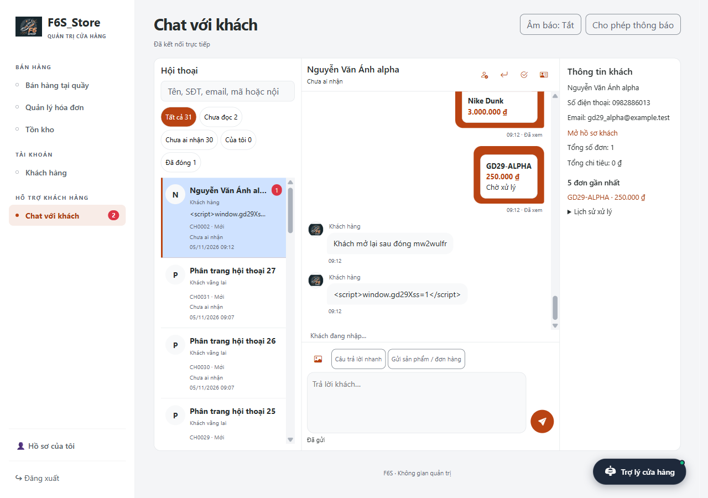
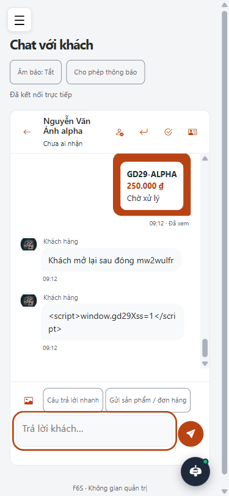

# Giai đoạn 29 — Inbox nhân viên, menu và email báo tin

Nhánh `hoan-thien-chat-thanh-toan`. Chỉ triển khai giai đoạn 29. Không push/merge. Dùng lại SupportChatService/Socket/ảnh/renderer và AccountMailService, không đổi luật giá, kho, hủy đơn hoặc doanh thu.

## Môi trường

Bản sao mới **shopbangiay_kt_20261105_gd29**, RESTORE từ full backup đọc được gần nhất lúc bắt đầu (04/11/2026 22:42:17). Guard từ chối nếu DB đích đã tồn tại; chỉ restore lại checkpoint của bản sao tự tạo sau mỗi nhóm phá dữ liệu. Chỉ kết nối bản sao này và master metadata, **không kết nối shopbangiay/shopbangiay_thu**. App cổng **18429**, `ddl-auto=validate`, RULES, mail/geocoding bên ngoài tắt. SMTP test là GreenMail localhost. App phải có dòng Started trước browser.

Các file bằng chứng không chứa cookie/CSRF token/mật khẩu fixture/SMTP. Lượt browser FAIL cũng giữ lại, không xóa để làm đẹp kết quả.

## Bảng nghiệm thu

Tổng theo bảng: **29 PASS / 3 FAIL / 1 NOT TESTED**. FAIL toàn dự án được giữ nguyên, không đánh đồng với các ca inbox đã PASS.

| Hạng mục | Cách kiểm tra | Kết quả thực tế | PASS/FAIL/NOT TESTED |
|---|---|---|---|
| Menu | Playwright Admin/Nhân viên + rg | Không còn nhóm HỆ THỐNG/HỖ TRỢ cũ; chỉ Chat với khách trong nhóm mới; hồ sơ/đăng xuất ở chân | PASS |
| Chân sidebar | Đo geometry sidebar dài | Vùng menu cuộn riêng, footer trong viewport, không chồng nhau | PASS |
| Hồ sơ/email thử/đăng xuất | Bấm các nút thật | Trang hồ sơ mở, POST email thử trả cảnh báo chưa cấu hình, đăng xuất chặn lại trang chat | PASS |
| Route cũ | GET sáu URL phiếu/FAQ, gồm new/edit/ID chữ | 302 → /admin/chat; rg src/main chỉ còn literal tại lớp redirect | PASS |
| Chuyển phiếu cũ | Migration 028 hai lần với 3 phiếu giả | Mới/Đang xử lý/Đã xong → MOI/DANG_XU_LY/DA_DONG; tin đầu có nội dung/trích đoạn, có tin trả lời; không nhân đôi | PASS |
| Phản hồi phiếu cũ gắn tài khoản | Playwright live + SQL | Badge gộp 1 → 0, khách nhận trực tiếp, nhân viên thấy Đã xem | PASS |
| Trích đoạn dài | Phiếu giả có hơn 2.000 ký tự | Chia thành các tin tối đa 2.000, giữ dữ liệu phiếu gốc | PASS |
| Phiếu trong backup gốc | SELECT trước migration | Có 0 phiếu gốc; 3 phiếu chỉ là dữ liệu test và đã được bỏ bằng RESTORE | PASS |
| Layout inbox | Playwright 1280/375 + ảnh | Ba khung desktop; mobile danh sách ↔ chat; thông tin khách bằng dialog, Escape trả focus | PASS |
| Tìm kiếm/tab | Tên/liên hệ/nội dung/mã và 5 tab | Các số đếm khớp COUNT độc lập trong SQL | PASS |
| Tải thêm hội thoại | Seed 27 hội thoại rỗng giả | Trang đầu đúng 20, tải thêm không nhân đôi; ngoại lệ STT/phân trang 12 theo yêu cầu | PASS |
| Tin mới lên đầu | Khách + hai nhân viên + Admin mở cùng lúc | Danh sách và badge cập nhật không reload; thời gian đo trong realtime-proof | PASS |
| Nhận/trả về/đóng/mở lại | Nút icon + xác nhận đóng | Có audit người/hành động/thời gian; không có xóa | PASS |
| Phối hợp nhân viên | A nhận, B xem và trả lời | B thấy cảnh báo Đang được A phụ trách; trả lời không đổi người phụ trách | PASS |
| Khách mở lại | Đóng khi đã trả về hàng chờ, khách nhắn | Cùng hội thoại mở lại MOI, không có người nhận | PASS |
| Hai chiều/đã xem/đang nhập | Context khách và nhân viên | Tin, Đã xem và chỉ báo nhập hoạt động | PASS |
| Ảnh/thẻ | UI gửi ảnh, sản phẩm và đơn của khách | Khách nhận đủ; thẻ đơn phía nhân viên đi qua route mở hóa đơn | PASS |
| Bộ chọn sản phẩm | Gửi thẻ bằng UI | Chỉ hiện sản phẩm đang bán có biến thể đang bán; hết lỗi chọn sản phẩm trống | PASS |
| Thông tin khách | SELECT độc lập + link | Tổng đơn/chi tiêu khớp; hóa đơn trong 5 đơn gần nhất mở HTTP200; guest chỉ có thông tin tự điền | PASS |
| Câu trả lời nhanh | Chọn mẫu và kiểm tra ô nhập | 5 mẫu tiếng Việt + FAQ KHACH đang bật; chỉ điền để sửa, không tự gửi | PASS |
| Badge/tab/âm báo | UI và reload | Badge đồng bộ, title (n) Chat với khách; mặc định âm tắt, bật/tắt nhớ trên trình duyệt | PASS |
| Email khách offline | GreenMail, last-seen quá 2 phút | Một thư UTF-8 có trích đoạn và link; HTML đã escape | PASS |
| Chống spam email | Hai trả lời trong 30 phút | Chỉ một thư, một mail log SENT | PASS |
| Online/không email/chưa cấu hình/SMTP tắt | Integration + app mail disabled | Online hoặc không email không gửi; chưa cấu hình bỏ qua có log; SMTP tắt ghi FAILED, tin vẫn lưu | PASS |
| REST/quyền kênh nhân viên | Guest/User thật + STOMP | API 403; /topic/support-staff trả ERROR, không lộ nội dung | PASS |
| CSRF thao tác | Thiếu/sai token trên claim/queue/close/reopen | 8 phản hồi 403; giá trị assignee gửi giả bị bỏ qua | PASS |
| XSS | Gửi <script> từ khách | Hiện chữ trong preview/bubble, không chạy mã | PASS |
| Trợ lý cửa hàng | Hỏi Tin nhắn mới + SELECT | Báo đúng tổng chưa đọc/chưa ai nhận và link /admin/chat | PASS |
| Schema | Startup validate sau migration | App Started cổng 18429, không thiếu schema | PASS |
| Clean test đầy đủ | mvnw clean test, không skip | Xem tổng cuối và đối chiếu baseline phía dưới | FAIL |
| Crawl toàn bộ | 4 vai trò, BFS hết link | 766 URL, không HTTP4xx/5xx, không thiếu CSRF form; còn lỗi CDN/POS nền | FAIL |
| Audit UI strict toàn repo | audit_project.py strict | 247 findings, gồm giới hạn nhận diện handler JS/CSS và lỗi nền; không tuyên bố sạch toàn repo | FAIL |
| Mail tới hộp thư thật, âm thanh nghe được, notification OS/điện thoại thật | Không có bằng chứng thiết bị/dịch vụ thật | Hướng dẫn thử ở README; chưa xác nhận bằng thiết bị thật | NOT TESTED |

## SQL, status, ảnh và mail

Bằng chứng đầy đủ tại `docs/evidence/gd29/`:

- `tickets-before.json`, `schema-first.json`, `schema-second.json`, `migration-first.txt`, `migration-second.txt`: phiếu trước/sau, mapping, COUNT và cột; lần hai không đổi.
- `inbox-realtime-proof.json`, `inbox-sql.json`: thời gian nhận, người phụ trách, audit, tin và da_xem_luc.
- `filters-proof.json` cạnh `filters-sql.json`: số trên UI/API và SELECT độc lập; `customer-metrics-sql.json` đối chiếu thông tin khách. Tổng chi tiêu dùng cùng RevenueCondition với thống kê (PAID, loại hủy/giao thất bại, quy tắc ship lịch sử giữ nguyên).
- `security-proof.json`, `staff-security-proof.json`, `admin-tool-proof.json` và mọi lượt `browser-results.json`.
- `URL_STATUS.md`: toàn bộ URL | vai trò | status. 20 khách + 25 user + 217 nhân viên + 504 admin = 766 URL; 0 lỗi HTTP trang, 0 form POST thiếu CSRF.
- `mail-captured.txt`: thư giả thực nhận từ GreenMail, nội dung UTF-8 và HTML escape; không có bí mật mail.

```sql
SELECT id,ma,trang_thai,legacy_ticket_id FROM chat_hoi_thoai WHERE legacy_ticket_id IS NOT NULL;
SELECT hoi_thoai_id,nguoi_gui_loai,noi_dung,da_xem_luc FROM chat_tin_nhan ORDER BY id;
SELECT hoi_thoai_id,user_id,actor_name,hanh_dong,created_at FROM chat_action_audit ORDER BY id;
SELECT hoi_thoai_id,message_id,trang_thai,created_at FROM chat_mail_log ORDER BY id;
SELECT COUNT(*) FROM chat_hoi_thoai WHERE chua_doc_nhan_vien>0;
SELECT COUNT(*) FROM chat_hoi_thoai WHERE assigned_user_id IS NULL AND trang_thai<>N'DA_DONG';
```

Các COUNT trong test đã loại alias lịch sử không thuộc inbox theo cùng phạm vi dữ liệu; truy vấn độc lập nằm trong JSON. Các ví dụ trên dùng để vận hành sau khi biết ID thực, không truy cập DB bị cấm trong phiên này.

## Lỗi đã sửa trong phạm vi

| Mã | Vị trí | Nguyên nhân và sửa | Kiểm tra lại |
|---|---|---|---|
| GD29-01 | service/hotro/SupportChatService.java:164 | Dùng employee_id không đủ cho Admin không có employee; thêm assigned_user_id; B trả lời không chiếm người phụ trách | Integration + 3 context PASS |
| GD29-02 | repository/hotro/SupportChatInboxRepository.java:23 | Picker có sản phẩm trống không tạo được thẻ; lọc EXISTS biến thể đang bán theo luật đang có | Gửi thẻ thật PASS |
| GD29-03 | static/js/staff-chat.js:15 | Gửi lỗi dữ liệu giữ pending khiến chọn lại vẫn retry giá trị cũ; bỏ pending với lỗi 400/403/413/415, lỗi mạng giữ clientId | UI retry/chọn lại + idempotency hồi quy |
| GD29-04 | templates/admin/chat/inbox.html:2 | Admin layout không nạp font Bootstrap Icons; dùng bộ cục bộ có sẵn | Ảnh và kiểm tra font 1280/375 PASS |
| GD29-05 | static/js/quan-tri-danh-muc.js:187 | Autosize chung ép ô chat cao 110px; hỗ trợ data-min-height=52 riêng cho chat, form cũ giữ 110 | Hai viewport PASS |
| GD29-06 | database/migrations/028_hop_thu_nhan_vien.sql:13 | Audit không được chặn luồng xóa tài khoản cũ; lưu snapshot actor_name, giữ audit sau khi xóa | Test hồi quy mới, xem kết quả cuối |

GD29-07 tại `database/migrations/028_hop_thu_nhan_vien.sql:19`: cú pháp EXEC ghép QUOTENAME không hợp lệ trong bản nháp; đã dùng biến + sp_executesql, migration lặp PASS. `migration-first-failed.txt` giữ lỗi gốc.

Lượt FAIL của script được giữ: locator XSS trùng preview/bubble; tìm kiếm còn ở tab Đã đóng; phiên Admin đã logout cần login lại; MIME phải giải mã thay vì so chuỗi quoted-printable. Đây là lỗi harness/expectation, không gộp vào lỗi nghiệp vụ. Một assertion menu cũ được đổi để kiểm tra Hồ sơ ở footer và menu Chat mới đúng yêu cầu; không xóa test.

## Chỗ đã thay đổi so với giai đoạn cũ

- Thay hai màn phiếu/FAQ bằng inbox; URL cũ 302, giữ bảng/dữ liệu và chuyển phiếu sang hội thoại một lần. Trích đoạn dài được chia tin, không cắt phiếu gốc.
- FAQ không còn trang quản trị riêng. FAQ KHACH đang bật làm mẫu trả lời khách; FAQ nội bộ và kiến thức trợ lý vẫn giữ.
- Bỏ nhóm HỆ THỐNG cùng hồ sơ trùng; chân sidebar giữ hồ sơ/đăng xuất. Ma trận quyền vẫn chỉ AdminAccess, cập nhật PHAN_QUYEN.md.
- Lõi chat dùng người phụ trách bằng user_id; admin không cần có employee. Nhân viên khác được trả lời nhưng không đổi người nhận, audit lưu tên snapshot.
- Email nền sau commit cho khách offline >2 phút, cooldown 30 phút **cho cả lần thử thất bại**, để không spam SMTP khi dịch vụ lỗi. Không lưu nội dung/email đích vào chat_mail_log; trạng thái PENDING/SENT/FAILED. Mất cấu hình mail không chặn tin.
- Broker/presence vẫn một instance như giai đoạn 28. Không triển khai hạ tầng nhiều instance hay tự gửi mail thật.

## Migration trên DB vận hành — chỉ hướng dẫn

Sao lưu trước. Chạy **028 sau 027**, đã cập nhật `chay_tat_ca.sql` và `shopgiay.sql`. Không tự chạy khi app khởi động, không DROP bảng/cột dữ liệu. Tạo file vận hành riêng:

```sql
EXEC sys.sp_set_session_context @key=N'shop.allow-production-migration', @value=1;
:r database/migrations/028_hop_thu_nhan_vien.sql
```

```powershell
sqlcmd -S <SERVER> -E -d <TEN_DB_VAN_HANH> -b -f 65001 -i <FILE_VAN_HANH.sql>
```

Guard chỉ mở tên DB vận hành được chỉ rõ khi có cờ session. Lệnh này **chưa chạy trên shopbangiay/shopbangiay_thu**. Khởi động lại validate; cấu hình mail qua env/local và PUBLIC_BASE_URL đúng địa chỉ HTTPS. Đọc README về proxy WebSocket, private upload và giới hạn một instance.


## Test cuối và các lần sửa test

`mvnw.cmd -B -o clean test` ngày 05/11/2026: **314 tests, 22 failures, 1 error, 0 skipped** (291 PASS). Tất cả 23 ca còn lỗi thuộc baseline606ead2; không có tên ca lỗi mới. `SupportChatInboxIntegrationTest` **6/6**, `SupportChatMailIntegrationTest` **3/3**, hồi quy core chat **15/15**, engine khách **11/11**, SchemaCheck **4/4**, Admin engine **8/8**. Build toàn dự án vẫn FAIL, không tuyên bố đã xanh. Bằng chứng: test-summary.json và maven-summary.txt.

Test cũ EmployeeAccessIntegrationTest.matrixAndMenuUseSamePolicyAndInventoryIsReadOnly đã đổi assertion: nav phải có Chat với khách, Hồ sơ của tôi phải nằm ở footer cùng Đăng xuất; bỏ yêu cầu cũ nav chứa account vì trái yêu cầu A1. Giữ nguyên các kiểm tra quyền/tồn kho và không xóa test.

Trong vòng kiểm thử có lỗi cú pháp EXEC động của migration audit khi ghép QUOTENAME; đã chuyển sang biến SQL + sp_executesql, chạy lại migration hai lần và validate sạch. Giữ output migration-first-failed.txt để đối chiếu. Không chạy test trên DB vận hành.

### Nội dung thư giả thực nhận

SMTP giả nhận tiêu đề “Cửa hàng đã trả lời tin nhắn của bạn - F6S Store”, người nhận gd29-mail@example.test. Bản text sau giải mã:

```text
Xin chào Nguyễn Văn Ánh,

Nhân viên cửa hàng vừa trả lời bạn:
Xin chào Nguyễn Văn Ánh <script>không chạy</script>

Xem cuộc trò chuyện: http://localhost:8080/?support=open

Trân trọng,
F6S Store
```

Bản HTML trong cùng MIME có `&lt;script&gt;`/`&lt;/script&gt;` và entity tiếng Việt hợp lệ. Bản text không được thực thi như HTML. Xem mail-captured.txt; thư thứ hai trong 30 phút không gửi thêm, SMTP tắt ghi FAILED nhưng message vẫn có trong DB. Giá trị localhost:8080 là cấu hình URL mặc định trong test, khi triển khai dùng PUBLIC_BASE_URL.


## Ảnh và đối chiếu cuối

| Desktop | Mobile |
|---|---|
|  |  |

Ca cuối `final-ui-recovery-proof.json`: upload giả .png bị 400, sau đó gửi tin mới thành công đúng 1 bản ghi, audit trả tên snapshot Admin và icon có glyph. `after-final-restore.json` xác nhận **40/40 bảng khớp checkpoint**, test_users=0, test_orders=0, chat_threads=0, chat_messages=0, chat_audit=0, chat_mail=0. App đã dừng; không còn phiên app kiểm thử chạy trên 18429. Không chạy gì trên hai database bị cấm.


### Đồng bộ phiếu cũ với khung chat của khách

GD29-08 tại `service/hotro/SupportChatService.java:135`, `:150` và `SupportChatEvents.java:18`: hội thoại chuyển đổi có thể khác ID hội thoại hiện tại của cùng tài khoản. Đã gộp số chưa đọc của khách theo chủ sở hữu, cập nhật receipt cho các tin cũ thật sự hiển thị, và phát tín hiệu sau commit tới các kênh thuộc cùng chủ. Phía nhân viên vẫn đọc từng hội thoại riêng. Không phát nội dung ra kênh công khai.

`legacy-live-proof.json`/`legacy-live-sql.json` ghi kết quả thật: trả lời phiếu cũ, khách ở hội thoại hiện tại nhận badge1, mở chat về0, nhân viên thấy Đã xem; test tích hợp riêng kiểm tra lịch sử và counter. Test mới nâng tổng lên314; không có lỗi mới so baseline. Chân sidebar 375px cũng đã đo sau khi hiệu ứng mở hoàn tất, footer nằm trong viewport và link hồ sơ dùng được.
